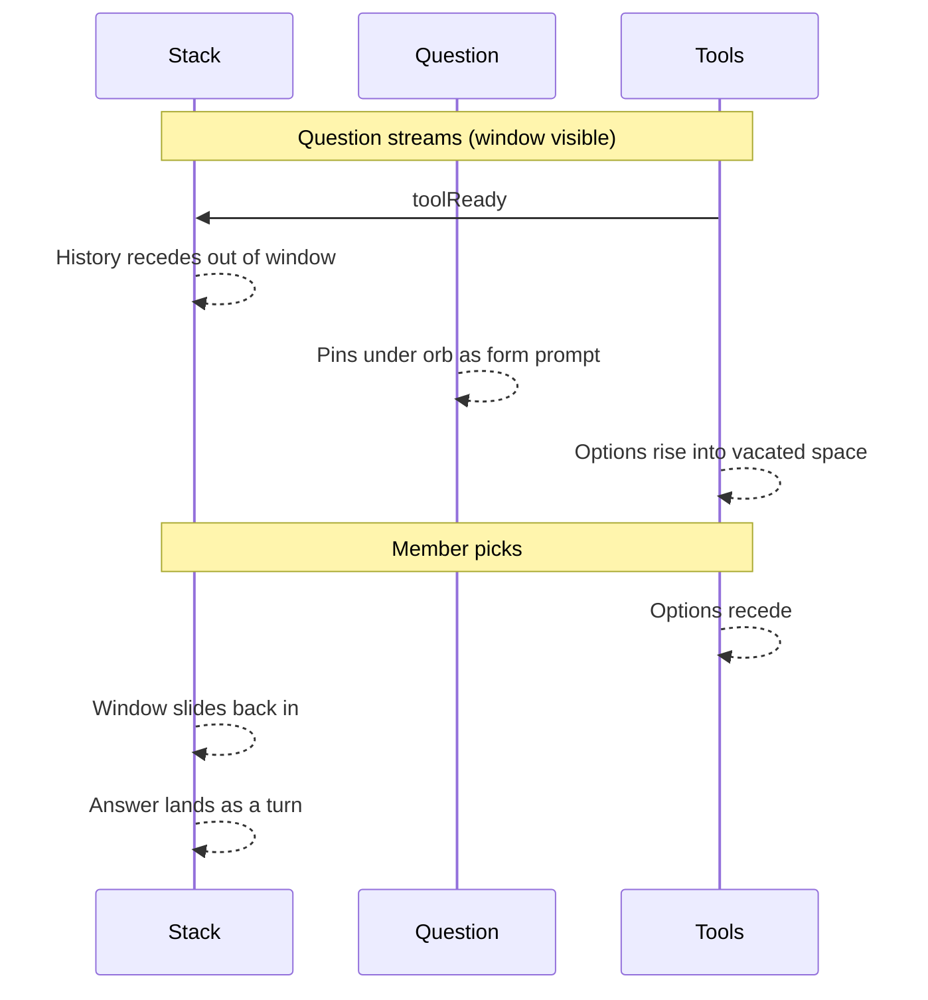

# Phoenix form stack compact

Prototype: [`app/goncalo/phoenix-conversational-onboarding`](app/goncalo/phoenix-conversational-onboarding)

## Locked decisions (grill)

**Rhythm.** Compact only while options are on screen. After a pick, the sliding window returns so the answer (and any care line) can play. Compact again when the next tool rises. Converse, then choose.

**Motion.** Mix of pull-up and form. Older lines recede up (fade + height collapse) and **leave the window**. The live question stays under the orb as the form prompt — same serif, not a smaller field label. Options take everything below. One coordinated motion with the tool rise.

**Inverse.** On pick: tools recede, the stack slides back down into the window, the answer lands as a turn. Care line / next question play in that restored stack.

**Scope.** Area, duration, intensity, yes/no, more, and doors. Guide and ready stay expanded. Orb stays at ~80px during Know-you (existing compact layout). Sliding window, fade, no scroll — unchanged when not choosing.

## Implementation

Shared layout lives in [`conversation-variants.tsx`](app/goncalo/phoenix-conversational-onboarding/conversation-variants.tsx) `StackFrame` (all three speaker-diff variants). Tools live in [`phoenix-scene.tsx`](app/goncalo/phoenix-conversational-onboarding/phoenix-scene.tsx) `ToolShell`.

- `isCompact` = `toolReady` and step is `know` | `more` | `doors`
- Animate `StackFrame` `max-height` from `STACK_WINDOW_MAX_PX` to the current question’s height; keep `justify-end` + `overflow: hidden` so history clips off the top (question pulls up, tools move up)
- Fade older turns to 0 while compact; hide the top fade/blur mask
- `ToolShell`: play `rise-out` instead of unmounting to `h-0` immediately; 800ms `cubic-bezier(0.22, 1, 0.36, 1)` to match `rise-in`
- Do not change script, orb layout, or variant speaker-diff
